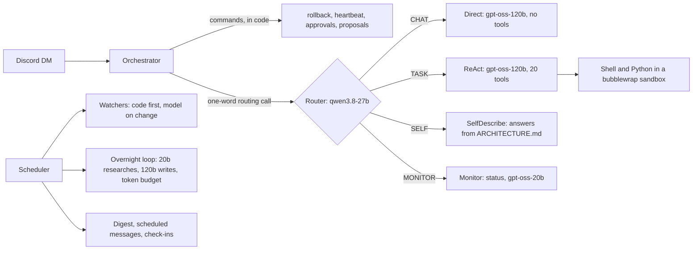

# I.G.O.R.

**An always-on personal AI agent, run in production on free tiers, with the safety
engineering most agents skip.**

I.G.O.R. lives in Discord DMs and works for one person. It answers questions, runs
multi-step tasks with tools, watches prices and job boards, writes research overnight,
and proposes fixes to its own mistakes for approval. It has been in daily use since
mid-2026, on a 1 GB free-tier server and Groq's free API tier. That budget shapes
nearly every design decision below.

## What it does

- **Chat and tasks.** A fast, tool-less model answers conversation. Anything that needs
  action goes to a ReAct agent with 20 tools: web search and fetch, memory, files,
  a sandboxed shell, scheduling, standing goals and delegation to sub-agents.
- **Watchers.** Prices, restocks, job postings, freelance gigs, and any page the user
  names on a heartbeat. Code checks for changes and only a real change reaches a model,
  so a quiet day costs no tokens.
- **Overnight work.** An hourly loop from midnight to 7am works standing goals inside a
  fixed token budget: it searches, distils sourced findings and revises one living
  research paper, which an evaluator must pass before it replaces the last version.
- **Learning from corrections.** Corrections and logged errors become proposed fixes
  the user approves or rejects. Nothing changes without a yes.
- **Senses.** Voice notes are transcribed, images described, and PDFs, Word, Excel and
  notebook files read.

## How it is built

Python 3.10, discord.py, the OpenAI SDK pointed at Groq, Exa for search, APScheduler,
and Markdown plus SQLite for memory, on an Oracle Always Free VM (1 OCPU, 956 MB RAM).
[ARCHITECTURE.md](ARCHITECTURE.md) is the full description, kept verified against the
source; the agent reads it to answer questions about itself.

## Engineering decisions worth a look

**Prompt injection is contained by structure, not by a classifier.** The moment a web
tool runs in a turn, every state-changing tool (shell, file and memory writes,
scheduling, goals, delegation) is withdrawn from the schema and refused at execution
for the rest of that turn. Private files and the open web never share a turn. Fetched
text arrives wrapped in untrusted-content markers.

**The agent cannot reach what judges it.** Deploys go through a root-owned script
outside the repo: it compiles, imports every module, restarts, waits for the Discord
gateway and rolls back to the previous commit on any failure. A separate timer restarts
the bot if its gateway connection goes silent. The agent can edit its own code, but not
the gate that decides whether that code ships.

**Shell commands run in a sandbox.** bubblewrap gives each command no network, a clean
environment, its own process table and a read-only filesystem apart from a scratch
folder. Building it exposed a
real leak: the service's secrets were in its environment and every subprocess inherited
them. If the sandbox cannot start, commands are refused rather than run unprotected.

**The free tier is the spec.** Groq limits are per model, so roles are spread across
models to use separate buckets. The daily cap only appears in 429 bodies, so it was
measured from one: 200,000 tokens a day for chat and tasks, about 55 agent turns.
Every model is a reasoning model, so budgets have floors below which output comes back
silently empty. When the main model is rate-limited, a fallback chain moves to a smaller
model (a second provider slots in once its key is set) and the reply says so.

**Code decides what it can; a model judges the rest.** Watchers diff in code. Advocacy
drafts are checked in code: every percentage and dollar figure must appear on the
source page, or the draft is rewritten or dropped. Commands such as rollback and
heartbeat are parsed in code, so no model decides to undo anything.

**Recoverable by default.** Every file the agent changes is checkpointed first, and
`rollback` restores it, keeping files someone edited since. Conversation that scrolls
out of the six-message window is folded into a running summary instead of lost. Memory
notes are pushed hourly to a private repo by a key the agent cannot read.

## Results

| Measure | Value |
|---|---|
| Router accuracy, live | 23 of 24 cases, the same across three consecutive runs |
| Self-description eval, live | 11 of 11 (first run 7 of 11; fixes in [STATE.md](STATE.md)) |
| Offline test suite | 47 files, 1,580 checks, no API calls |
| Daily token budget | 200,000 on the main model, measured from a 429 response |
| Host | 1 OCPU, 956 MB RAM, Oracle Always Free |
| History | 366 commits since May 2026 |

Features are benchmarked against the documentation of Nous Research's
[Hermes Agent](https://hermes-agent.nousresearch.com/docs): where IGOR matches it, where
it deliberately differs (bubblewrap instead of Docker on a 1 GB host, page diffs instead
of a full agent turn per heartbeat), and where it does more (structural injection
containment, a deploy gate the agent cannot modify).

## Limits, honestly

- One user, one Discord DM, by design. There is no public demo to try.
- About 55 agent turns a day on the free tier. Long live sessions can run out.
- The internal-address check has a known gap, DNS rebinding, and pages that render
  only with JavaScript cannot be watched.
- The host is an Always Free VM, which Oracle has terminated once. Off-host backups and
  alerts exist for exactly that.

## Repository map

| Path | What it is |
|---|---|
| [ARCHITECTURE.md](ARCHITECTURE.md) | What the system is today, verified against the code |
| [STATE.md](STATE.md) | The running log: what is deployed, what broke, what was measured |
| [GAMEPLAN.md](GAMEPLAN.md) | The work queue, with what was decided and why |
| [IGOR_SPEC.md](IGOR_SPEC.md) | The original vision |
| [CLAUDE.md](CLAUDE.md) | Working rules for the coding agent used to build it |
| `agents/` | Direct, ReAct, Monitor, research, overnight loop, watchers |
| `tests/` | The offline suite (`python tests/test_<name>.py`) and live evals |
